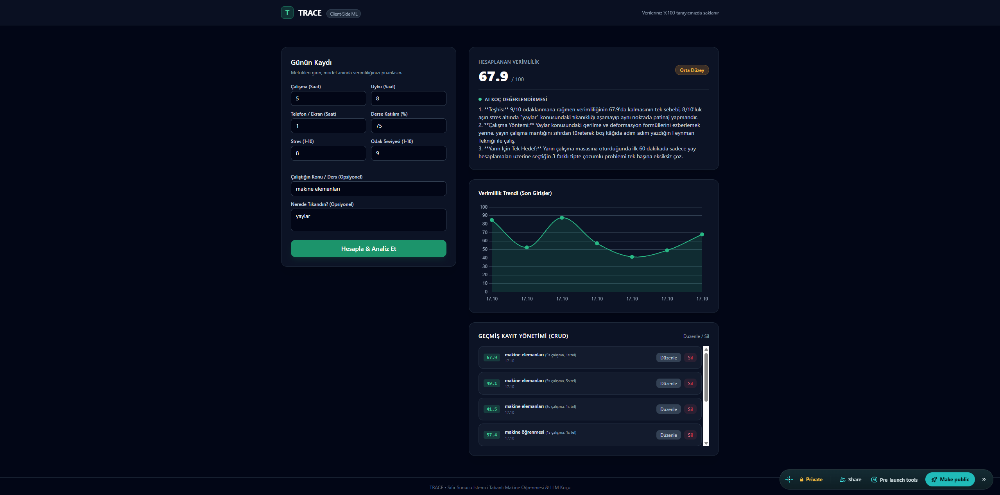

# TRACE - AI Destekli Verimlilik Takip & Koçluk Platformu

TRACE, öğrencilerin günlük akademik ve odaklanma metriklerini tarayıcı üzerinde çalışan istemci tabanlı makine öğrenmesi modeliyle (Linear Regression) puanlayan, LocalStorage üzerinde CRUD işlemlerine olanak tanıyan ve Gemini API destekli Netlify Serverless Function ile kişiselleştirilmiş koçluk sunan bir web uygulamasıdır.

## 🚀 Canlı Demo
- **Netlify Canlı Linki:** https://harmonious-conkies-717bdf.netlify.app/

## 📸 Ekran Görüntüsü

## 🛠 Kullanılan Teknolojiler & Özellikler
- **Frontend & Tasarım:** HTML5, Modern JavaScript (ES6+), Tailwind CSS, Chart.js
- **Veri Saklama (CRUD):** LocalStorage (Kayıt Ekleme, Listeleme, Güncelleme, Silme)
- **Makine Öğrenmesi (Client-Side ML):** Scikit-learn Linear Regression katsayıları ile tarayıcıda anlık verimlilik tahmini
- **Yapay Zeka (Serverless):** Netlify Functions & Google Gemini Flash API entegrasyonu